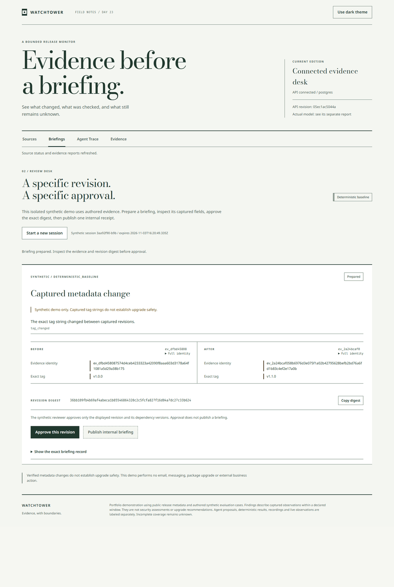

# Watchtower

Failed collection must not look like a quiet source. Watchtower captures bounded release metadata, checks typed differences, freezes evidence for review and recovers an internal publication receipt after a lost response.

The required implementation and release checks are complete.

Portfolio demonstration using public release metadata and authored synthetic evaluation cases. Findings describe captured observations within a declared window. They are not security assessments or upgrade recommendations. Agent proposals, deterministic results, recordings and live observations are labeled separately. Incomplete coverage remains unknown.

Run the deterministic evaluation with npm run evaluate. Start the interface with npm start. Use the direct Neon Postgres connection for durable deployment, with local SQLite available for isolated development. Run npm test for verification and npm run eval:model for the separate actual local model lane. Read docs/operator.md before a collection or hosted run.

Open RESULTS.md for code-rendered baseline and actual-model tables. Actual inference attempted 24 sequences from the registered 24 sequences. Supported proposals: 0 findings. The registered model demonstration criteria did not pass. Failures and unexecuted cases remain in the declared denominator. Previewed findings remain unapproved. No preview is represented as a publication.

Recorded failed case: [asset_metadata_edit-heldout-05](reports/model/runs/actual-2026-11-01T16-50-21-528Z/asset_metadata_edit-heldout-05.json). Its recorded failure code is model_turn_budget_exhausted. This case remains in the declared denominator.

Verified API: https://watchtower-mekala27-45s-projects.vercel.app. Verified Pages site: https://mekala27-45.github.io/watchtower/. Actual collection dispatch evidence: https://github.com/mekala27-45/watchtower/actions/runs/41666485561. Public release evidence: https://github.com/mekala27-45/watchtower/releases/tag/day23-watchtower-v0.1.0.

Recorded browser demonstration. This image is not a live service status.

## Claims this evidence can support

- Changes to captured release metadata within the declared observation window.
- Behavior on the named authored synthetic scenarios and recorded failure cases.
- Recovery of a committed internal publication receipt using the same operation key.
- What the evaluated local model and observed tool handlers did under the frozen configuration.

## Claims this evidence cannot support

- Complete source history or deletion inferred from missing items.
- Security assessments, compatibility conclusions or upgrade recommendations.
- General model accuracy outside the frozen authored subset.
- Exactly once effects across arbitrary external services.
- Exact schedule timing or an unverified automatic collection run.

## Completion

1. **done** Source, dependency and free-host probes are recorded and checked. reports/probes verifies source identities, pinned dependencies, Neon Free direct TLS, a READY Vercel Hobby API and the public GitHub Pages host. reports/verification/public-live.json passes all 4 hosted checks at 05ec1ac.

2. **done** Claim renderer and every required gate pass their three cases. reports/verification/gate-three-cases.json maps 17 admission gates to clean, deliberate-violation and empty-input cases. The 45-test focused run passes without skips; actual model quality remains separately failed.

3. **done** Temporal fixtures, independent truth and evaluation plan are frozen. fixtures/manifest.json and docs/evaluation-plan.json retain the original 144-sequence corpus and frozen 24-case subset; docs/model-freeze.json pins the actual runtime.

4. **done** Collector enforces metadata policy, cache scope and honest coverage. reports/collection/operator-20261101T1645.json records 8 real HTTP attempts and 4 partial captures with no false usable heads; collector and Postgres retention tests verify exact cache scope.

5. **done** Durable source state and fenced leases pass independent checks. tests/postgres.test.mjs verifies independent pools, immutable observations, lease expiry and stale generation refusal against Neon; reports/faults/postgres-matrix.json adds stored-state proofs.

6. **done** Typed detector and verifier pass independent truth and mutation tests. reports/baseline/full.json records 72 held-out sequences,42/42 matched findings and 210 forged-proposal rejections against independent truth.

7. **done** Digest-bound review and atomic publication pass stale and retry cases. reports/browser/postgres.json and Postgres tests verify named stale dependencies, digest-bound approval and one receipt recovered through an independent client.

8. **done** Functional API is live and verified by browser and separate client. reports/verification/public-live.json verifies public PostgreSQL readiness, exact revision and CORS. reports/browser/public-api.json passes 9 browser checks, including publication, identical receipt recovery and a separate client finding exactly one receipt.

9. **done** One actual local agent executes only the three permitted tools. reports/model/current.json records actual provider-directed calls and 26 handler executions; every dispatched inventory contains only the 3 permitted tools.

10. **done** Full baseline and declared model subset ran with complete denominators. reports/baseline/full.json ran 72 sequences; reports/model/current.json preserves all 24 actual sequence attempts,20 completed and 4 failed, including all 28 transition denominators.

11. **done** Actual model quality is reported, including whether supported proposals occurred. reports/model/current.json reports 0 supported proposals,0/13 recall and 5 correct no-op or uncertainty outcomes; the useful-model criterion did not pass.

12. **done** Applicable failure cases recover with independent stored-state assertions. reports/faults/postgres-matrix.json records 541/541 applicable cases recovered,35 not applicable and 109 real process terminations, with independent database assertions.

13. **done** Proof-sheet UI, both themes and accessibility checks are complete. reports/browser/postgres.json passes 14 checks and reports/browser/public-api.json passes 9 public checks across both themes, mobile, keyboard, labels and actual receipt recovery; palette verification has zero failures.

14. **done** Public Pages site completes the visible API review and receipt flow. reports/browser/pages.json passes all 9 public Pages browser checks at 05ec1ac, including the visible compiled UI, digest-bound review, receipt recovery and a separate client verifying exactly one receipt.

15. **done** Governance, notices, source policy, skills and retention checks are complete. Notices, source policy, operator helpers and repository skills are committed; actual Postgres retention tests pass 5/5 with no skipped cases.

16. **done** Actual dispatch succeeded and schedule configuration is reported honestly. Actions run 41666485561 completed successfully. reports/verification/actions-storage.json independently verifies all 8 database assertions, 8 HTTP attempts and 4 partial captures. The six-hour UTC schedule is enabled; no scheduled run is claimed.

17. **done** Final reports, scans, live checks and clean worktree rederivation pass. A fresh checkout of 05ec1ac passed 160 tests without skips, both 541-case recovery matrices, typechecking, build and 14 browser checks on a proven separate empty database. Public Pages passes 9 checks and Actions storage passes 8 assertions. Revalidation preserved the actual model archive without inference.

18. **done** Release commits and tag are verified, with public release state explicit. reports/verification/public-release.json records public release 432917389, annotated tag day23-watchtower-v0.1.0, matching remote target 34a6db638a8e1c57ca763ee3026a895483052897 and the uploaded source archive SHA-256. Later publication evidence does not amend the released tag.
