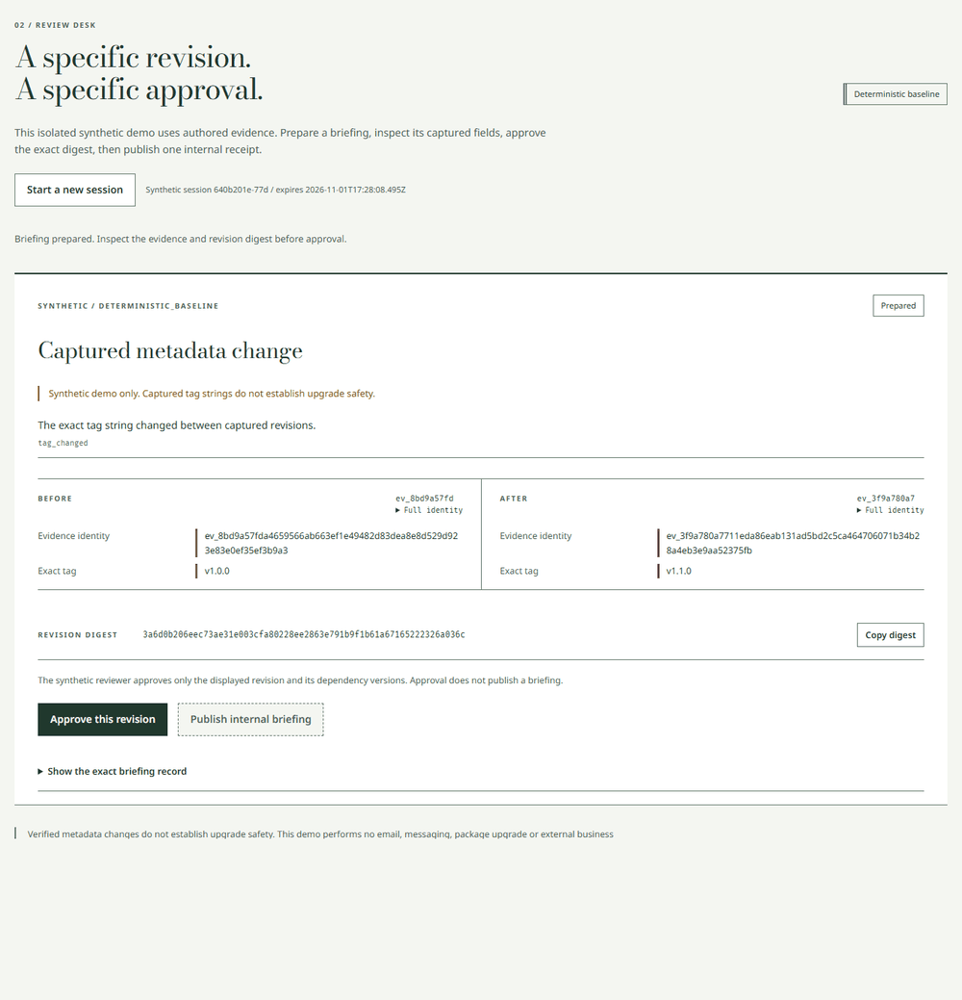

# Watchtower

Failed collection must not look like a quiet source. Watchtower captures bounded release metadata, checks typed differences, freezes evidence for review and recovers an internal publication receipt after a lost response.

Implementation and verification results are recorded below. Any unfinished requirement remains marked not done in the completion checklist.

Portfolio demonstration using public release metadata and authored synthetic evaluation cases. Findings describe captured observations within a declared window. They are not security assessments or upgrade recommendations. Agent proposals, deterministic results, recordings and live observations are labeled separately. Incomplete coverage remains unknown.

Run the deterministic evaluation with npm run evaluate. Start the interface with npm start. Use the direct Neon Postgres connection for durable deployment, with local SQLite available for isolated development. Run npm test for verification and npm run eval:model for the separate actual local model lane. Read docs/operator.md before a collection or hosted run.

Open RESULTS.md for code-rendered baseline and actual-model tables. Actual inference attempted 24 sequences from the registered 24 sequences. Supported proposals: 0 findings. The registered model demonstration criteria did not pass. Failures and unexecuted cases remain in the declared denominator. Previewed findings remain unapproved. No preview is represented as a publication.

Recorded failed case: [asset_metadata_edit-heldout-05](reports/model/runs/actual-2026-11-01T16-50-21-528Z/asset_metadata_edit-heldout-05.json). Its recorded failure code is model_turn_budget_exhausted. This case remains in the declared denominator.

A public API is not verified. A public Pages site is not verified. Actual Actions dispatch is not verified. A public release is not verified.

Recorded browser demonstration. This image is not a live service status.

## Claims this evidence can support

- Changes to captured release metadata within the declared observation window.
- Behavior on the named authored synthetic scenarios and recorded failure cases.
- Recovery of a committed internal publication receipt using the same operation key.
- What the evaluated local model and observed tool handlers did under the frozen configuration.

## Claims this evidence cannot support

- Complete source history or deletion inferred from missing items.
- Security assessments, compatibility conclusions or upgrade recommendations.
- General model accuracy outside the frozen authored subset.
- Exactly once effects across arbitrary external services.
- Exact schedule timing or an unverified automatic collection run.

## Completion

1. **not done** Source, dependency and free-host probes are recorded and checked. reports/probes records verified source IDs, package integrity, CPU artifact, Neon Free direct TLS and Vercel Hobby; public GitHub and container deployment checks remain blocked.

2. **not done** Claim renderer and every required gate pass their three cases. Contract gates are tested; the registered useful-model criterion failed because actual supported proposals are zero. See reports/model/current.json.

3. **done** Temporal fixtures, independent truth and evaluation plan are frozen. fixtures/manifest.json and docs/evaluation-plan.json retain the original 144-sequence corpus and frozen 24-case subset; docs/model-freeze.json pins the actual runtime.

4. **done** Collector enforces metadata policy, cache scope and honest coverage. reports/collection/operator-20261101T1645.json records 8 real HTTP attempts and 4 partial captures with no false usable heads; collector and Postgres retention tests verify exact cache scope.

5. **done** Durable source state and fenced leases pass independent checks. tests/postgres.test.mjs verifies independent pools, immutable observations, lease expiry and stale generation refusal against Neon; reports/faults/postgres-matrix.json adds stored-state proofs.

6. **done** Typed detector and verifier pass independent truth and mutation tests. reports/baseline/full.json records 72 held-out sequences,42/42 matched findings and 210 forged-proposal rejections against independent truth.

7. **done** Digest-bound review and atomic publication pass stale and retry cases. reports/browser/postgres.json and Postgres tests verify named stale dependencies, digest-bound approval and one receipt recovered through an independent client.

8. **not done** Functional API is live and verified by browser and separate client. The Postgres API works locally in browser and separate-client checks; public Vercel deployment is blocked on database-secret destination approval.

9. **done** One actual local agent executes only the three permitted tools. reports/model/current.json records actual provider-directed calls and 26 handler executions; every dispatched inventory contains only the 3 permitted tools.

10. **done** Full baseline and declared model subset ran with complete denominators. reports/baseline/full.json ran 72 sequences; reports/model/current.json preserves all 24 actual sequence attempts,20 completed and 4 failed, including all 28 transition denominators.

11. **done** Actual model quality is reported, including whether supported proposals occurred. reports/model/current.json reports 0 supported proposals,0/13 recall and 5 correct no-op or uncertainty outcomes; the useful-model criterion did not pass.

12. **done** Applicable failure cases recover with independent stored-state assertions. reports/faults/postgres-matrix.json records 541/541 applicable cases recovered,35 not applicable and 109 real process terminations, with independent database assertions.

13. **done** Proof-sheet UI, both themes and accessibility checks are complete. reports/browser/postgres.json records 14 passed real-browser checks across both themes, mobile, focus, stale review and receipt recovery; reports/verification/palette.json has zero failures.

14. **not done** Public Pages site completes the visible API review and receipt flow. No public Pages site exists yet; repository creation requires an accessible restored Chrome window.

15. **done** Governance, notices, source policy, skills and retention checks are complete. Notices, source policy, operator helpers and repository skills are committed; actual Postgres retention tests pass 5/5 with no skipped cases.

16. **not done** Actual dispatch succeeded and schedule configuration is reported honestly. The local operator collection succeeded with honest partial coverage; no Actions dispatch has run. The committed UTC schedule remains gated off.

17. **not done** Final reports, scans, live checks and clean worktree rederivation pass. Final report and clean-worktree checks are being preserved; public live checks remain blocked, so this requirement is not done.

18. **not done** Release commits and tag are verified, with public release state explicit. The local candidate release is prepared; the required public repository, remote tag and release remain pending.
